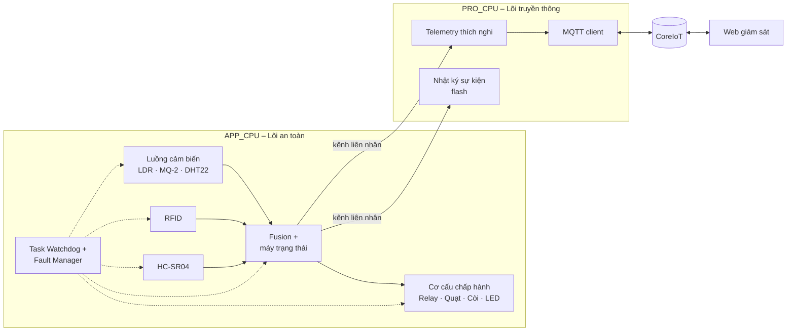
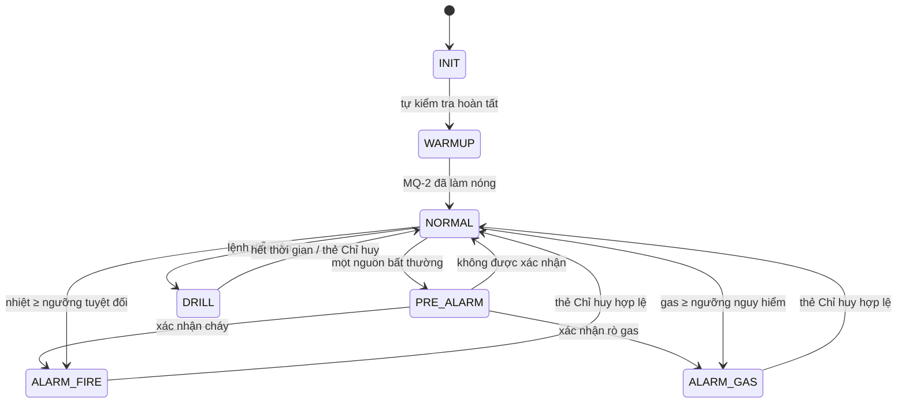
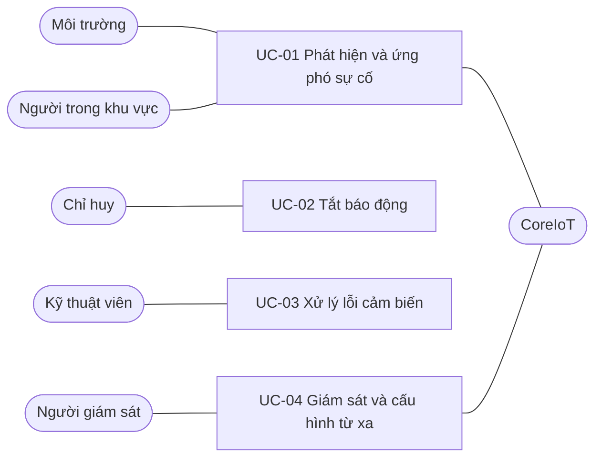

# Đặc tả yêu cầu kỹ thuật: FireGuard-RT

**Hệ thống cảnh báo và xử lý đám cháy thời gian thực đa tầng, tích hợp giám sát lỗi, trên Zephyr RTOS**

| Thuộc tính | Giá trị |
|---|---|
| Phiên bản | 0.2 |
| Nền tảng phần cứng | ESP32-WROOM-32 (NodeMCU 30 chân) |
| Hệ điều hành | Zephyr RTOS 4.4, đa xử lý bất đối xứng (AMP) trên 2 nhân |
| Nền tảng IoT | CoreIoT (giao thức MQTT, mô hình dữ liệu ThingsBoard) |
| Tiêu chuẩn tham chiếu | TCVN 5738:2021, Hệ thống báo cháy tự động – Yêu cầu kỹ thuật |

---

## 1. Mô tả chung

### 1.1 Mục tiêu

FireGuard-RT là nút báo cháy tự động cho một khu vực (phòng hoặc hành lang). Hệ thống có các chức năng chính:

- Tổng hợp dữ liệu từ nhiều cảm biến để phát hiện và phân loại sự cố (**cháy** hoặc **rò khí gas**), đồng thời loại trừ báo động giả.
- Kích hoạt cơ cấu ứng phó khẩn cấp.
- Hỗ trợ cứu hộ.
- Tự giám sát tình trạng hoạt động của chính hệ thống.

Hệ thống được thiết kế theo hướng **an toàn tới hạn** (safety-critical) với hai nguyên tắc:

1. Chuỗi xử lý phát hiện–ứng phó có quyền ưu tiên cao nhất và được cách ly với tác vụ truyền thông.
2. Mọi luồng xử lý cảm biến đều chịu sự giám sát của watchdog.

### 1.2 Phạm vi

| Trong phạm vi | Ngoài phạm vi |
|---|---|
| Phát hiện cháy (lửa/nhiệt kết hợp khói) và rò khí gas | Phát hiện cháy âm ỉ |
| Ngắt điện, hút khói, còi, đèn chỉ dẫn thoát hiểm | Kết nối nhiều nút, mạng mesh |
| Xác thực người chỉ huy bằng RFID | Mã hóa kênh truyền (TLS) |
| Giám sát và cấu hình từ xa qua CoreIoT và web | Chứng nhận hợp chuẩn PCCC |

### 1.3 Thuật ngữ

| Thuật ngữ | Định nghĩa |
|---|---|
| Thời gian phát hiện | Khoảng thời gian từ khi xuất hiện yếu tố đặc trưng của sự cố tại cảm biến đến khi hệ thống chuyển sang trạng thái ALARM. Tương ứng với "thời gian tác động" của đầu báo cháy theo TCVN 5738:2021 |
| Thời gian phản ứng | Khoảng thời gian từ khi hệ thống chuyển sang ALARM đến khi relay, quạt và còi đều đã được kích hoạt |
| Chu kỳ lấy mẫu (`sample_period`) | Khoảng thời gian giữa hai lần đọc cảm biến liên tiếp |
| Chu kỳ gửi (`callin_period`) | Khoảng thời gian giữa hai lần gửi telemetry lên CoreIoT khi hệ thống ở trạng thái bình thường |
| Lõi an toàn | Tập luồng phát hiện–ứng phó, chạy trên APP_CPU với kernel riêng |
| Lõi truyền thông | Tập luồng Wi-Fi, MQTT và nhật ký, chạy trên PRO_CPU |
| Chế độ suy giảm | Chế độ vận hành khi có ít nhất một cảm biến bị cô lập do lỗi |

### 1.4 Phần cứng

| Thành phần | Vai trò | Giao tiếp | GPIO |
|---|---|---|---|
| ESP32 NodeMCU (30 chân) | Bộ xử lý trung tâm | — | — |
| Quang trở LDR | Phát hiện ánh sáng ngọn lửa (vai trò đầu báo lửa) | ADC1_CH7 | 35 |
| MQ-2 | Phát hiện khói và khí gas (vai trò đầu báo khói/gas) | ADC1_CH6, qua phân áp | 34 |
| DHT22 | Nhiệt độ, độ ẩm (vai trò đầu báo nhiệt) | 1-wire | 4 |
| HC-SR04 | Phát hiện chuyển động của người trong vùng nguy hiểm | TRIG / ECHO (ECHO qua phân áp) | 27 / 26 |
| RFID RC522 | Xác thực thẻ Chỉ huy | SPI (VSPI) | SCK 18, MISO 19, MOSI 23, CS 5, RST 22 |
| Relay 1 kênh | Ngắt nguồn điện khu vực | GPIO | 13 |
| Quạt 5V qua MOSFET | Hút khói, thông gió | GPIO (PWM) | 33 |
| Còi (buzzer) | Báo động âm thanh | GPIO | 25 |
| LED RGB | Chỉ thị trạng thái, chỉ dẫn thoát hiểm | GPIO | R 16, G 17, B 21 |

### 1.5 Kiến trúc tổng quan

Trong mỗi lõi, các luồng trao đổi dữ liệu qua kênh zbus. Giữa hai lõi, kênh liên nhân (IPM kết hợp bộ nhớ chia sẻ) chuyển tiếp các kênh zbus theo cơ chế không chặn: lõi an toàn không bao giờ chờ lõi truyền thông. Lệnh cấu hình từ xa được kiểm tra hợp lệ rồi mới áp dụng vào lõi an toàn.

### 1.6 Trạng thái hệ thống

Lỗi cảm biến được biểu diễn bằng cờ `FAULT` riêng cho từng cảm biến, tồn tại song song với mọi trạng thái.

| Trạng thái | Relay | Quạt | Còi | LED RGB | HC-SR04 |
|---|---|---|---|---|---|
| INIT, WARMUP | Cấp điện | Tắt | Tắt | Xanh dương nháy chậm | Tắt |
| NORMAL | Cấp điện | Tắt | Tắt | Xanh lá | Tắt |
| NORMAL có FAULT | Cấp điện | Tắt | Bíp ngắn mỗi 30 s | Vàng nháy | Tắt |
| PRE_ALARM | Cấp điện | Tắt | Bíp ngắn mỗi 5 s | Cam nháy | Tắt |
| ALARM_FIRE | Ngắt | Bật | Liên tục | Đỏ / xanh lá xen kẽ | Quét |
| ALARM_GAS | Ngắt | Bật | Ngắt quãng | Đỏ / xanh lá xen kẽ | Quét |
| ALARM, có người trong vùng | Ngắt | Bật | Như trên | Xen kẽ tần số cao | Quét |
| DRILL | Cấp điện | Bật | Ngắt quãng ngắn | Tím nháy | Quét |

---

## 2. Yêu cầu chức năng

| ID | Tên | Mô tả |
|---|---|---|
| **FR-01** | Thu thập dữ liệu cảm biến | Hệ thống đọc LDR và MQ-2 theo `sample_period`, mặc định 1 s, miền cho phép 1–2 s. DHT22 được đọc với chu kỳ max(`sample_period`, 2 s). Mỗi mẫu mang dấu thời gian và cờ chất lượng (`OK`, `FAULT`). Hệ thống duy trì giá trị nền (baseline) thích nghi cho LDR và MQ-2. |
| **FR-02** | Phát hiện và phân loại sự cố | Hệ thống tổng hợp các nguồn để phân loại: **ALARM_FIRE** khi ánh sáng tăng đột biến được xác nhận bởi khói hoặc nhiệt tăng, hoặc khi nhiệt độ vượt ngưỡng tuyệt đối; **ALARM_GAS** khi nồng độ gas vượt ngưỡng cảnh báo liên tục mà không có dấu hiệu lửa, hoặc vượt ngưỡng nguy hiểm. Một nguồn bất thường chưa được xác nhận chỉ đưa hệ thống vào PRE_ALARM và tự hủy sau cửa sổ xác nhận. Các ngưỡng có hysteresis. |
| **FR-03** | Ứng phó khẩn cấp | Khi vào ALARM, hệ thống đồng thời ngắt relay, bật quạt, kích còi và chuyển LED sang chế độ chỉ dẫn thoát hiểm theo bảng 1.6. |
| **FR-04** | Hỗ trợ cứu hộ | Trong trạng thái ALARM, hệ thống quét HC-SR04. Khi phát hiện khoảng cách biến thiên lặp lại (có chuyển động), hệ thống đặt cờ "còn người trong vùng nguy hiểm", gửi sự kiện lên CoreIoT và tăng tần số nháy LED. |
| **FR-05** | Xác thực Chỉ huy | Chỉ thẻ RFID có UID thuộc danh sách Chỉ huy mới tắt được báo động. Khi đó hệ thống trở về NORMAL và tiếp tục giám sát; nếu điều kiện sự cố vẫn còn, hệ thống báo động lại. Thẻ không hợp lệ bị từ chối và được ghi nhận. |
| **FR-06** | Giám sát lỗi và chịu lỗi | Mỗi luồng cảm biến đăng ký một kênh Task Watchdog với thời hạn 500 ms. Khi kênh hết hạn hoặc dữ liệu cảm biến bất hợp lý (lỗi giao tiếp, bão hòa ADC, không có tín hiệu phản hồi), hệ thống cô lập cảm biến, chuyển sang chế độ suy giảm, phát cảnh báo bảo trì và thử khởi động lại luồng. Nếu luồng fusion hoặc luồng chấp hành bị treo, hệ thống khởi động lại bằng watchdog phần cứng và khôi phục trạng thái báo động trước đó. |
| **FR-07** | Telemetry thích nghi và nhật ký | Ở NORMAL, hệ thống gửi giá trị mới nhất theo `callin_period` (mặc định 60 s, miền 10–600 s). Ở PRE_ALARM, ALARM và DRILL, hệ thống gửi theo `sample_period`. Các sự kiện (chuyển trạng thái, lỗi, xác thực thẻ, có người trong vùng) được gửi ngay. Sự kiện được lưu vào nhật ký vòng trên flash và gửi bù khi kết nối được khôi phục. |
| **FR-08** | Giám sát và cấu hình từ xa | Web giám sát hiển thị trạng thái, giá trị cảm biến, cờ lỗi và nhật ký sự kiện. Web cho phép cấu hình `sample_period`, `callin_period` và các ngưỡng (qua shared attributes của CoreIoT), và khởi chạy chế độ diễn tập (qua RPC). Thiết bị kiểm tra miền giá trị của mọi tham số. Không có lệnh từ xa nào tắt được báo động. |

---

## 3. Yêu cầu phi chức năng

| ID | Tên | Mô tả | Phương pháp kiểm chứng |
|---|---|---|---|
| **NFR-01** | Thời gian phát hiện | Tuân thủ thời gian tác động tối đa theo TCVN 5738:2021 cho từng loại đầu báo mà cảm biến đảm nhận: **lửa ≤ 5 s** (LDR kết hợp xác nhận), **khói/gas ≤ 30 s** (MQ-2), **nhiệt ≤ 120 s** (DHT22). Áp dụng với mọi giá trị `sample_period` trong miền cho phép. | Thực nghiệm, mỗi kịch bản ≥ 20 lần |
| **NFR-02** | Thời gian phản ứng và cách ly | Thời gian phản ứng ≤ 1 s, không phụ thuộc vào tải mạng. Lõi an toàn chạy trên APP_CPU, tách biệt với Wi-Fi và MQTT trên PRO_CPU; trong mỗi lõi, lập lịch ưu tiên chiếm quyền với luồng chấp hành có độ ưu tiên cao nhất. Mọi luồng của lõi an toàn thỏa mãn phân tích thời gian đáp ứng (RTA): R_i = C_i + B_i + Σ_{j∈hp(i)} ⌈R_i/T_j⌉·C_j ≤ D_i. | RTA kết hợp Zephyr Tracing, so sánh hai điều kiện có và không có tải mạng |
| **NFR-03** | Độ tin cậy | Phát hiện luồng cảm biến bị treo trong ≤ 500 ms. Tự phục hồi sau khi lõi an toàn bị treo trong ≤ 3 s. Vận hành liên tục 24 giờ không treo. Chức năng phát hiện và ứng phó tại chỗ vẫn hoạt động đầy đủ khi mất kết nối mạng. Khi bất kỳ một cảm biến môi trường nào bị lỗi, hệ thống vẫn phát hiện được ít nhất một loại sự cố. | Tiêm lỗi (rút dây, treo luồng), soak test |
| **NFR-04** | Độ chính xác phát hiện | Tỷ lệ phát hiện đúng ≥ 95% trên bộ kịch bản chuẩn. Không phát sinh ALARM trong các kịch bản gây nhiễu: bật/tắt đèn phòng, đèn pin chiếu thoáng qua, hơi thở vào cảm biến nhiệt. | Thực nghiệm theo bộ kịch bản |
| **NFR-05** | Khả năng bảo trì và kiểm thử | Mã nguồn tổ chức theo module (driver, cảm biến, fusion, chấp hành, an toàn, truyền thông). Logic fusion độc lập phần cứng. Tham số cấu hình qua Kconfig và devicetree. Có cấu hình build mô phỏng chạy trên Wokwi. Không cấp phát bộ nhớ động trong lõi an toàn. | Review mã, chạy mô phỏng |

---

## 4. Use case

### UC-01: Phát hiện và ứng phó sự cố

| Mục | Nội dung |
|---|---|
| Tác nhân | Môi trường, Người trong khu vực, CoreIoT |
| Tiền điều kiện | Hệ thống ở NORMAL hoặc PRE_ALARM |
| Luồng chính | 1. Luồng cảm biến ghi nhận giá trị bất thường; hệ thống vào PRE_ALARM và chuyển telemetry sang chu kỳ nhanh. 2. Nguồn thứ hai xác nhận trong cửa sổ xác nhận; hệ thống phân loại thành ALARM_FIRE hoặc ALARM_GAS. 3. Relay ngắt, quạt bật, còi kêu, LED chỉ dẫn thoát hiểm. 4. HC-SR04 quét vùng nguy hiểm; nếu phát hiện chuyển động thì gửi sự kiện "còn người trong vùng". 5. Sự kiện được ghi nhật ký và gửi lên CoreIoT. |
| Luồng thay thế | 2a. Không có xác nhận thì hệ thống trở về NORMAL. 2b. Nhiệt độ hoặc gas vượt ngưỡng tuyệt đối thì hệ thống vào ALARM trực tiếp. 2c. Đang ở chế độ suy giảm thì áp dụng luật xác nhận với các cảm biến còn hoạt động. |
| Hậu điều kiện | Hệ thống duy trì ALARM cho đến khi thực hiện UC-02 |
| Yêu cầu liên quan | FR-01, FR-02, FR-03, FR-04, FR-07, NFR-01, NFR-02, NFR-04 |

### UC-02: Tắt báo động bằng thẻ Chỉ huy

| Mục | Nội dung |
|---|---|
| Tác nhân | Chỉ huy |
| Tiền điều kiện | Hệ thống ở ALARM_FIRE, ALARM_GAS hoặc DRILL |
| Luồng chính | 1. Chỉ huy quẹt thẻ RFID. 2. Hệ thống đọc UID và đối chiếu với danh sách Chỉ huy. 3. Hệ thống tắt còi và quạt, cấp lại điện, LED về trạng thái bình thường, chuyển sang NORMAL. 4. Sự kiện được ghi nhật ký (UID, thời điểm, trạng thái trước đó) và gửi lên CoreIoT. |
| Luồng thay thế | 2a. UID không hợp lệ: phát âm báo lỗi, ghi nhật ký, giữ nguyên trạng thái. |
| Hậu điều kiện | Hệ thống ở NORMAL và tiếp tục giám sát; nếu điều kiện sự cố còn tồn tại thì UC-01 được kích hoạt lại |
| Yêu cầu liên quan | FR-05, FR-07 |

### UC-03: Xử lý lỗi cảm biến

| Mục | Nội dung |
|---|---|
| Tác nhân | Kỹ thuật viên |
| Tiền điều kiện | Hệ thống đang vận hành |
| Luồng chính | 1. Kênh Task Watchdog của một luồng cảm biến hết hạn, hoặc kiểm tra tính hợp lý thất bại. 2. Fault Manager đặt cờ FAULT, cô lập cảm biến và chuyển fusion sang chế độ suy giảm. 3. Hệ thống phát cảnh báo bảo trì tại chỗ và gửi sự kiện lên CoreIoT. 4. Fault Manager thử khởi động lại luồng; nếu thành công thì xóa cờ FAULT. 5. Nếu vẫn lỗi, kỹ thuật viên sửa chữa; hệ thống tự xóa cờ FAULT khi cảm biến hoạt động lại bình thường. |
| Luồng ngoại lệ | 1a. Luồng fusion hoặc luồng chấp hành bị treo: watchdog phần cứng khởi động lại hệ thống, sau đó hệ thống khôi phục trạng thái báo động trước đó. |
| Yêu cầu liên quan | FR-06, FR-07, NFR-03 |

### UC-04: Giám sát và cấu hình từ xa

| Mục | Nội dung |
|---|---|
| Tác nhân | Người giám sát, CoreIoT |
| Tiền điều kiện | Thiết bị đã kết nối CoreIoT |
| Luồng chính | 1. Người giám sát mở web và xem trạng thái, giá trị cảm biến, cờ lỗi, nhật ký. 2. Người giám sát thay đổi `sample_period`, `callin_period` hoặc ngưỡng. 3. CoreIoT chuyển shared attributes xuống thiết bị. 4. Thiết bị kiểm tra miền giá trị, áp dụng, lưu vào bộ nhớ không bay hơi và phản hồi kết quả. |
| Luồng thay thế | 2a. Người giám sát khởi chạy diễn tập; thiết bị vào DRILL trong thời gian quy định. 4a. Giá trị ngoài miền: thiết bị từ chối và giữ cấu hình cũ. |
| Yêu cầu liên quan | FR-07, FR-08 |

---

## 5. Giao diện dữ liệu CoreIoT

| Loại | Topic | Nội dung |
|---|---|---|
| Telemetry | `v1/devices/me/telemetry` | `{"state","light","gas","temp","hum","faults","trapped"}` |
| Sự kiện | `v1/devices/me/telemetry` | `{"event","detail","a","b","seq","uptime_ms"}` |
| Client attributes | `v1/devices/me/attributes` | `fw_version`, `device`, `cfg_<khóa>` (kết quả áp dụng cấu hình) |
| Shared attributes | `v1/devices/me/attributes` (nhận) | `sample_period_ms`, `callin_period_s`, `th_light_delta_mv`, `th_gas_rise_mv`, `th_gas_warn_mv`, `th_gas_danger_mv`, `th_temp_max_x10`, `th_temp_rise_x10`, `confirm_window_ms` |
| RPC | `v1/devices/me/rpc/request/+` | `startDrill` (`duration_s`), `stopDrill` |

## 6. Tài liệu tham chiếu

1. TCVN 5738:2021, Hệ thống báo cháy tự động – Yêu cầu kỹ thuật.
2. Zephyr Project Documentation: Task Watchdog; Tracing; zbus; IPM; ESP32 AMP.
3. ThingsBoard MQTT Device API (dùng cho CoreIoT).
