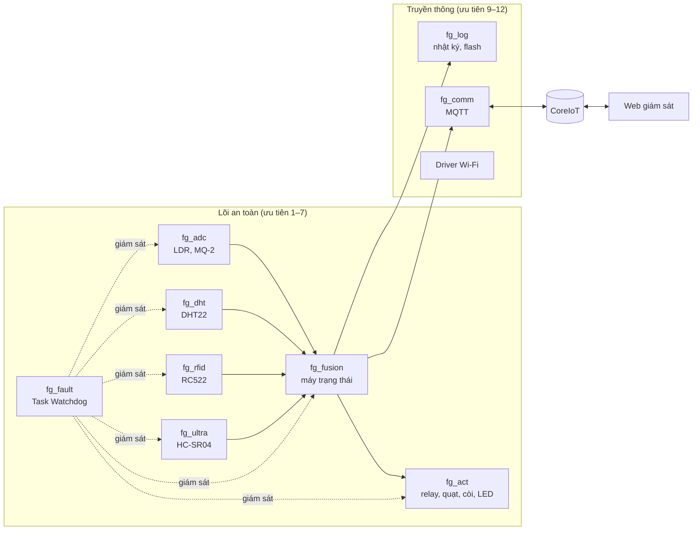
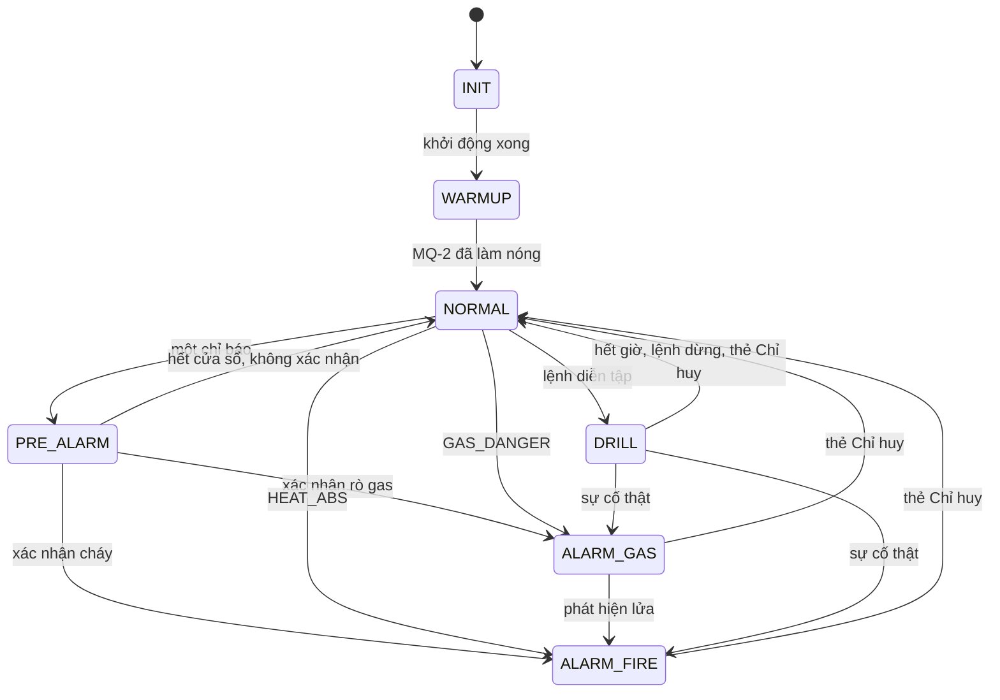

# Kiến trúc phần mềm

Tài liệu mô tả cách firmware FireGuard-RT tổ chức luồng, truyền dữ liệu, ra quyết định báo động và xử lý lỗi. Yêu cầu mà kiến trúc này đáp ứng nằm trong [`SRS.md`](SRS.md).

## 1. Tổng quan

Mỗi luồng cảm biến đọc phần cứng và phát kết quả lên một kênh zbus. `fg_fusion` nhận dữ liệu từ mọi kênh, chạy luật phát hiện và phát trạng thái mới. `fg_act` nhận trạng thái và điều khiển phần cứng ngay trong lần đánh thức đó. Luồng nhật ký và luồng mạng chỉ đọc trạng thái; lõi an toàn không bao giờ chờ chúng.

## 2. Luồng và độ ưu tiên

Số ưu tiên nhỏ hơn là ưu tiên cao hơn. Zephyr lập lịch chiếm quyền theo ưu tiên cố định.

| Luồng | Ưu tiên | Kích hoạt | Hạn Task Watchdog | Khi hết hạn |
|---|---|---|---|---|
| `fg_act` | 1 | Trạng thái mới trên `chan_state`, tick 50 ms | 1000 ms | Khởi động lại chip |
| `fg_fault` | 2 | Hàng đợi lỗi, tick 250 ms | 1000 ms | Khởi động lại chip |
| `fg_fusion` | 3 | Dữ liệu mới, tick 100 ms | 1000 ms | Khởi động lại chip |
| `fg_adc` | 4 | `sample_period_ms` | 500 ms | Cô lập cảm biến, khởi động lại luồng |
| `fg_dht` | 5 | max(`sample_period_ms`, 2 s) | 500 ms | Cô lập cảm biến, khởi động lại luồng |
| `fg_ultra` | 6 | 200 ms khi đang báo động | 500 ms | Cô lập cảm biến, khởi động lại luồng |
| `fg_rfid` | 7 | 200 ms | 500 ms | Cô lập cảm biến, khởi động lại luồng |
| `fg_log` | 9 | Sự kiện mới | | |
| `fg_comm` | 10 | Poll 100 ms | | |
| Luồng driver Wi-Fi | ≥ 12 | | | |

`comm.conf` đặt `CONFIG_ESP32_WIFI_MAX_THREAD_PRIORITY=12` để mọi luồng của driver Wi-Fi nằm dưới lõi an toàn. Luồng nhận dữ liệu được gắn với kênh bằng `zbus_obs_attach_to_thread`, nên luồng phát tạm thời được nâng lên ưu tiên của luồng nhận trong lúc thông báo, tránh đảo ưu tiên.

Không luồng nào trong lõi an toàn cấp phát bộ nhớ động. Stack của mọi luồng được cấp tĩnh trong `src/app/threads.c`.

## 3. Kênh dữ liệu

| Kênh | Nội dung | Phát | Nhận |
|---|---|---|---|
| `chan_adc` | Điện áp LDR, MQ-2, cờ hợp lệ | `fg_adc` | fusion |
| `chan_dht` | Nhiệt độ, độ ẩm (×10) | `fg_dht` | fusion |
| `chan_presence` | Có người trong vùng nguy hiểm | `fg_ultra` | fusion |
| `chan_rfid` | UID vừa quẹt, hợp lệ hay không | `fg_rfid`, shell | fusion, log |
| `chan_state` | Trạng thái, nguyên nhân, cờ lỗi, cờ có người | fusion | act, log, comm, ultra |
| `chan_fault` | Lỗi cảm biến xuất hiện hoặc hết | fault manager, luồng cảm biến | fusion, log |
| `chan_config` | Chín tham số cấu hình | shell, comm, storage | fusion, cảm biến |
| `chan_cmd` | Lệnh bắt đầu, dừng diễn tập | shell, comm | fusion |

`chan_config` có validator. zbus từ chối mọi bản cấu hình nằm ngoài miền (xem [`coreiot-web.md`](coreiot-web.md#3-cấu-hình-từ-xa)), nên giá trị sai từ shell, CoreIoT hay flash đều không lọt vào fusion.

## 4. Phát hiện sự cố

`src/fusion/fusion.c` là C thuần, không gọi kernel, nhận thời gian hiện tại làm tham số. Nhờ vậy unit test chạy được trên `native_sim` và đo được WCET.

Mỗi mẫu, fusion tính sáu chỉ báo:

| Chỉ báo | Điều kiện | Ý nghĩa |
|---|---|---|
| `LIGHT` | LDR tăng hơn `th_light_delta_mv` so với nền | Ánh sáng ngọn lửa |
| `SMOKE` | MQ-2 tăng hơn `th_gas_rise_mv` so với nền | Khói |
| `GAS_WARN` | MQ-2 trên `th_gas_warn_mv` | Rò gas |
| `GAS_DANGER` | MQ-2 trên `th_gas_danger_mv` | Gas nguy hiểm |
| `HEAT_RISE` | Nhiệt độ tăng hơn `th_temp_rise_x10` trong khoảng 10 s | Nhiệt tăng nhanh |
| `HEAT_ABS` | Nhiệt độ trên `th_temp_max_x10` | Nhiệt vượt ngưỡng |

Giá trị nền của LDR và MQ-2 là trung bình trượt hàm mũ (hằng số thời gian khoảng 30 s ở 1 Hz) và chỉ cập nhật khi hệ thống ở `NORMAL` không có chỉ báo nào. Một chỉ báo đã bật chỉ tắt khi giá trị xuống dưới 80 % ngưỡng.

Luật quyết định:

- **ALARM_FIRE**: `HEAT_ABS`, hoặc `LIGHT` được `SMOKE` hay `HEAT_RISE` xác nhận trong `confirm_window_ms`. Khi LDR lỗi, `SMOKE` cùng `HEAT_RISE` thay thế.
- **ALARM_GAS**: `GAS_DANGER`, hoặc `GAS_WARN` ba mẫu liên tiếp mà không có `LIGHT` trong cửa sổ.
- **PRE_ALARM**: một chỉ báo chưa được xác nhận. Hết cửa sổ mà không có xác nhận, hệ thống về `NORMAL`.
- Rò gas phát sinh lửa chuyển từ `ALARM_GAS` lên `ALARM_FIRE`. Báo động giữ nguyên cho tới khi Chỉ huy quẹt thẻ.

### 4.1 Máy trạng thái

Mỗi lần chuyển trạng thái mang một mã nguyên nhân (`fg_cause`), ví dụ `gas_danger`, `fire_confirmed`, `commander_override`. Nhật ký, telemetry và trang web đều hiển thị mã này.

### 4.2 Cơ cấu chấp hành theo trạng thái

| Trạng thái | Relay | Quạt (PWM) | Còi | LED RGB |
|---|---|---|---|---|
| INIT, WARMUP | Cấp điện | Tắt | Tắt | Xanh dương nháy 1 Hz |
| NORMAL | Cấp điện | Tắt | Tắt | Xanh lá |
| NORMAL có lỗi cảm biến | Cấp điện | Tắt | Bíp ngắn mỗi 30 s | Vàng nháy 1 Hz |
| PRE_ALARM | Cấp điện | Tắt | Bíp ngắn mỗi 5 s | Vàng nháy 2 Hz |
| ALARM_FIRE | Cắt | 100 % | Liên tục | Đỏ và xanh lá xen kẽ 2 Hz |
| ALARM_GAS | Cắt | 60–100 % theo mức gas | Ngắt quãng 1 Hz | Đỏ và xanh lá xen kẽ 2 Hz |
| ALARM, có người trong vùng | Cắt | Như trên | Như trên | Xen kẽ 5 Hz |
| DRILL | Cấp điện | 50 % | Bíp ngắn mỗi giây | Tím nháy 1 Hz |

Ở `ALARM_GAS`, duty quạt tăng tuyến tính từ 60 % tại ngưỡng cảnh báo tới 100 % tại ngưỡng nguy hiểm. Đường phản ứng đọc mức gas với `K_NO_WAIT`; nếu kênh đang bận, quạt chạy 100 % thay vì chờ.

Quẹt thẻ hợp lệ phát một tiếng bíp ngắn, thẻ lạ phát hai tiếng.

## 5. Chịu lỗi

### 5.1 Lỗi cảm biến

Firmware phát hiện lỗi cảm biến theo hai đường:

- **Treo**: luồng cảm biến không báo Task Watchdog trong 500 ms. Callback của Task Watchdog chạy trong ngắt, chỉ xoá kênh và chuyển mã luồng cho `fg_fault`.
- **Dữ liệu bất hợp lý**: chính luồng cảm biến báo lỗi khi bus lỗi, ADC bão hoà hoặc cảm biến không phản hồi.

`fg_fault` bật cờ lỗi của cảm biến đó trong `chan_state`, phát sự kiện bảo trì lên `chan_fault` và khởi động lại luồng. Nếu luồng treo lại quá `CONFIG_FG_FAULT_RESTART_MAX` lần (mặc định 3), `fg_fault` ngừng khởi động lại và giữ cảm biến ở trạng thái cô lập. Bộ đếm về 0 khi luồng chạy ổn định 60 s. Fusion chuyển sang chế độ suy giảm và dùng các cảm biến còn lại theo luật ở mục 4.

### 5.2 Lỗi lõi

`fg_act`, `fg_fusion` và `fg_fault` không có callback. Khi một trong ba luồng này bị treo quá 1 s, Task Watchdog để watchdog phần cứng khởi động lại chip. Trạng thái báo động nằm trong vùng RAM `__noinit`, nên sau khởi động lại fusion khôi phục `ALARM_FIRE` hoặc `ALARM_GAS` ngay, không qua giai đoạn làm nóng.

Lệnh `fg hang <luồng>` tiêm lỗi treo vào bất kỳ luồng nào để kiểm thử cơ chế này.

## 6. Lưu trữ

Khi bật `CONFIG_FG_PERSIST` (mặc định), firmware lưu dữ liệu bằng Zephyr settings trên NVS, phân vùng `storage_partition`:

| Khoá | Nội dung |
|---|---|
| `fg/cfg` | Cấu hình đã được chấp nhận |
| `fg/boot` | Số lần khởi động |
| `fg/evh` | Đầu đọc nhật ký: số thứ tự kế tiếp, số thứ tự đã gửi lên CoreIoT |
| `fg/ev/<slot>` | Một sự kiện trong vòng 64 slot |

Chỉ `fg_log` (ưu tiên 9) ghi flash, vì thao tác ghi tạm dừng cache của cả hai nhân và chặn mọi luồng trong thời gian đó. Firmware đo thời gian chặn này và đưa vào phân tích thời gian thực dưới dạng hệ số B (xem [`diagnostics.md`](diagnostics.md)).

Sau khi khởi động lại, firmware khôi phục cấu hình, giữ lịch sử sự kiện của các lần chạy trước và gửi bù những sự kiện chưa lên CoreIoT. `fg config reset` đưa cấu hình về mặc định và ghi đè bản đã lưu.

## 7. Đơn nhân hiện tại và hướng AMP

ESP32 có hai nhân. SRS đặt mục tiêu chạy lõi an toàn trên APP_CPU với kernel riêng và để PRO_CPU lo Wi-Fi. Driver Wi-Fi của Zephyr 4.4 phụ thuộc `!SMP`, nên phiên bản hiện tại chạy mọi luồng trên PRO_CPU và cách ly bằng độ ưu tiên:

- Lõi an toàn giữ ưu tiên 1–7, luồng mạng từ 9 trở xuống.
- Đường phát hiện đọc kênh zbus với thời gian chờ tối đa 10 ms; đường phản ứng không chờ.
- Phân tích RTA trên số đo thực (`fg rta`) kiểm chứng mọi luồng an toàn đạt hạn chót khi có tải CPU và tải mạng.

Bước chuyển sang AMP gồm build hai image, đặt lõi an toàn lên APP_CPU và nối hai bên bằng IPM với bộ nhớ chia sẻ theo kiểu không chặn. Các kênh zbus hiện có là ranh giới tự nhiên cho việc tách này.
