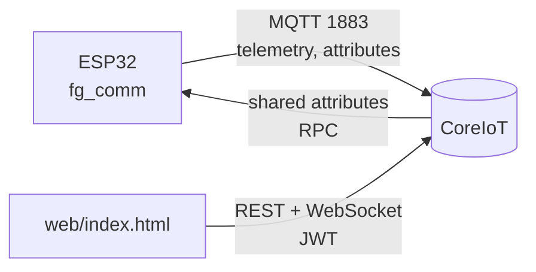

# CoreIoT và giao diện web

FireGuard-RT gửi dữ liệu lên CoreIoT (nền tảng ThingsBoard) qua MQTT và nhận cấu hình, lệnh diễn tập theo chiều ngược lại. Giao diện web trong `web/` đọc và ghi dữ liệu trực tiếp qua API của CoreIoT, không cần máy chủ riêng.



## 1. Thiết lập

1. Trên CoreIoT, vào **Entities** > **Devices**, tạo một device với profile mặc định và sao chép **access token**.
2. Tạo `secrets.conf` từ `secrets.conf.example` trong thư mục dự án:

```
CONFIG_FG_WIFI_SSID="Wokwi-GUEST"
CONFIG_FG_WIFI_PSK=""
CONFIG_FG_COREIOT_TOKEN="<access token>"
```

   Wokwi dùng mạng `Wokwi-GUEST` không mật khẩu. Trên board thật, điền SSID và mật khẩu Wi-Fi của bạn. `CONFIG_FG_COREIOT_HOST` (mặc định `app.coreiot.io`) và `CONFIG_FG_COREIOT_PORT` (mặc định 1883) cho phép trỏ tới máy chủ ThingsBoard khác.
3. Build với `comm.conf;secrets.conf` (xem [`getting-started.md`](getting-started.md#2-build)).
4. Kiểm tra log có `MQTT connected to CoreIoT`. Trên CoreIoT, device chuyển sang **Active** và tab *Latest telemetry* có dữ liệu.

Shared attribute là tuỳ chọn. Device chưa có shared attribute nào sẽ dùng cấu hình mặc định hoặc cấu hình đã lưu trên flash.

## 2. Giao thức dữ liệu

### 2.1 Topic MQTT

| Hướng | Topic | Nội dung |
|---|---|---|
| Thiết bị → CoreIoT | `v1/devices/me/telemetry` | Số đo và sự kiện |
| Thiết bị → CoreIoT | `v1/devices/me/attributes` | `fw_version`, `device`, `cfg_<khoá>` |
| CoreIoT → thiết bị | `v1/devices/me/attributes` | Shared attribute thay đổi |
| Thiết bị ↔ CoreIoT | `v1/devices/me/attributes/request/1`, `.../response/+` | Lấy toàn bộ shared attribute khi vừa kết nối |
| CoreIoT → thiết bị | `v1/devices/me/rpc/request/+` | Lệnh diễn tập |
| Thiết bị → CoreIoT | `v1/devices/me/rpc/response/<id>` | Kết quả lệnh |

### 2.2 Telemetry

```json
{"state":"NORMAL","light":1905,"gas":1242,"temp":28.0,"hum":60.0,"faults":0,"trapped":false}
```

| Khoá | Kiểu | Ý nghĩa |
|---|---|---|
| `state` | chuỗi | `INIT`, `WARMUP`, `NORMAL`, `PRE_ALARM`, `ALARM_FIRE`, `ALARM_GAS`, `DRILL` |
| `light` | số, mV | Điện áp LDR, cao hơn là sáng hơn |
| `gas` | số, mV | Điện áp MQ-2 |
| `temp` | số, °C | Nhiệt độ |
| `hum` | số, % | Độ ẩm tương đối |
| `faults` | số | Bitmask lỗi: bit 0 LDR, bit 1 MQ-2, bit 2 DHT22, bit 3 HC-SR04, bit 4 RC522 |
| `trapped` | boolean | Có người chuyển động trong vùng nguy hiểm |

Ở `INIT`, `WARMUP` và `NORMAL`, thiết bị gửi telemetry mỗi `callin_period_s`. Ở các trạng thái còn lại, thiết bị gửi mỗi `sample_period_ms`. Mỗi lần chuyển trạng thái, thiết bị gửi ngay một bản.

### 2.3 Sự kiện

Sự kiện đi qua cùng topic telemetry, QoS 1, ngay khi xảy ra:

```json
{"event":"state","detail":"ALARM_GAS","a":5,"b":8,"seq":42,"boot":3,"uptime_ms":81234}
```

| `event` | `detail` | `a` | `b` |
|---|---|---|---|
| `boot` | | 1 nếu watchdog gây khởi động lại | |
| `state` | Tên trạng thái mới | Mã trạng thái | Mã nguyên nhân (`fg_cause`) |
| `fault` | `light`, `gas`, `dht22`, `ultrasonic`, `rfid` | Mã cảm biến | Bit 0–6: loại lỗi (1 treo, 2 bất hợp lý); bit 7: 1 khi lỗi xuất hiện, 0 khi hết |
| `card` | UID 8 chữ số hex | 1 nếu là thẻ Chỉ huy | |
| `trapped` | | 1 khi phát hiện người, 0 khi vùng trống | |

`seq` tăng dần trong suốt vòng đời thiết bị, `boot` là số lần khởi động. Khi mất kết nối, sự kiện nằm lại trong nhật ký flash và được gửi bù theo đúng thứ tự khi kết nối lại.

Mã nguyên nhân: 0 `none`, 1 `boot`, 2 `warmup_done`, 3 `light_surge`, 4 `gas_rise`, 5 `heat_rise`, 6 `fire_confirmed`, 7 `gas_confirmed`, 8 `gas_danger`, 9 `heat_absolute`, 10 `not_confirmed`, 11 `commander_override`, 12 `drill_start`, 13 `drill_end`, 14 `restored_after_reset`.

## 3. Cấu hình từ xa

Đặt shared attribute trên device để đổi cấu hình. Thiết bị kiểm tra từng giá trị, áp dụng, lưu vào flash và trả kết quả qua client attribute `cfg_<khoá>` với giá trị `applied` hoặc `rejected`.

| Shared attribute | Mặc định | Miền firmware chấp nhận | Đơn vị |
|---|---|---|---|
| `sample_period_ms` | 1000 | 1000–2000 | ms |
| `callin_period_s` | 60 | 10–600 | s |
| `confirm_window_ms` | 4000 | 1000–4000 | ms |
| `th_light_delta_mv` | 800 | > 0 | mV |
| `th_gas_rise_mv` | 400 | > 0 | mV |
| `th_gas_warn_mv` | 1500 | > 0 | mV |
| `th_gas_danger_mv` | 2500 | > `th_gas_warn_mv` | mV |
| `th_temp_max_x10` | 570 | > 0 | 0,1 °C |
| `th_temp_rise_x10` | 30 | > 0 | 0,1 °C trong 10 s |

## 4. Diễn tập qua RPC

Gửi RPC hai chiều tới device:

| Method | Params | Tác dụng |
|---|---|---|
| `startDrill` | `{"duration_s": 30}` | Vào `DRILL` trong 5–600 s (giá trị ngoài miền bị kẹp lại) |
| `stopDrill` | `{}` | Kết thúc diễn tập |

Thiết bị trả `{"result":"ok"}` hoặc `{"result":"rejected"}`. CoreIoT trả HTTP 409 khi device offline và 408 khi device không trả lời kịp. Không có method nào tắt được báo động; sự cố thật luôn ưu tiên hơn diễn tập.

## 5. Giao diện web

### 5.1 Chạy

Giao diện là trang tĩnh, không cần build. Chọn một trong ba cách:

- Mở bản đang chạy tại [https://nguyen-hao-khang.github.io/fire-guard-rt/](https://nguyen-hao-khang.github.io/fire-guard-rt/).
- Mở `web/index.html` bằng trình duyệt.
- Phục vụ thư mục bằng máy chủ tĩnh bất kỳ, ví dụ `python -m http.server 8080 --directory web`, rồi mở `http://localhost:8080`.

Trang cần Internet để tải phông chữ và Chart.js 4.4.1 từ CDN. Workflow `.github/workflows/pages.yml` đưa thư mục `web/` lên GitHub Pages mỗi khi một commit thay đổi `web/` vào `main`; bạn cũng chạy tay được từ tab Actions (`pages` > *Run workflow*). Trang chỉ chứa mã giao diện, không chứa token hay mật khẩu: mỗi người đăng nhập bằng tài khoản CoreIoT của mình. CoreIoT cho phép gọi API từ domain khác, nên bạn cũng đưa được `web/` lên dịch vụ host tĩnh khác.

### 5.2 Đăng nhập

| Cách | Khi nào dùng | Thao tác |
|---|---|---|
| **Password** | Tài khoản CoreIoT có mật khẩu | Nhập email và mật khẩu |
| **Access token** | Tài khoản đăng nhập bằng Google hoặc GitHub | Trên CoreIoT, vào **Account** > **Security**, bấm **Copy JWT token**, dán vào trang |
| **View as guest** | Người chỉ cần xem, không có tài khoản | Bấm nút trên màn hình đăng nhập. Chỉ có Overview và History |

JWT có hiệu lực khoảng 2,5 giờ. Trang báo trước 5 phút và đưa bạn về màn hình đăng nhập khi token hết hạn. Để trang tự gia hạn, mở mục *Stay signed in longer* và dán thêm giá trị `refresh_token` lấy từ tab CoreIoT (DevTools > Application > Local storage).

Mỗi người đăng nhập bằng tài khoản của chính mình. Đừng gửi JWT của bạn cho người khác: JWT mang toàn bộ quyền của tài khoản đó.

#### Chế độ khách

Chế độ khách đăng nhập bằng customer *Public* của tenant (`POST /api/auth/login/public`) và chỉ thấy các device đã được chia sẻ công khai. Để bật:

1. Trên CoreIoT, vào **Entities** > **Devices**, chọn device, thêm nó vào nhóm device công khai (nhóm `PublicDevice`) hoặc bấm **Make public**.
2. Đặt `publicId` trong `web/assets/config.js` bằng id của customer *Public* (**Customers** > *Public* > sao chép id). Để trống thì nút **View as guest** bị ẩn.

Khách xem được số đo, trạng thái và lịch sử của device công khai. Khách không thấy trang Settings và không gửi được lệnh diễn tập. Bất kỳ ai có đường dẫn trang web cũng xem được dữ liệu của device đã công khai.

#### Tài khoản cho thành viên

Mỗi email trên CoreIoT chỉ thuộc một tenant. Email đã đăng ký CoreIoT trước đó không thêm được vào tenant khác. Thành viên có hai cách:

- Dùng tài khoản riêng, tạo device riêng trong tenant của mình và dán access token của device đó vào `secrets.conf`. Trang web làm việc với bất kỳ tenant nào, nên mỗi người tự kiểm thử với device của mình.
- Nếu cần thao tác trên device chung, chủ tenant thêm thành viên bằng một email chưa đăng ký CoreIoT (**Users** > **Tenant Administrators** > **+**, chọn *Display activation link* rồi gửi link cho thành viên tự đặt mật khẩu).

Trang giữ token trong `sessionStorage` của tab: đóng tab hoặc bấm đăng xuất sẽ xoá phiên. Trình duyệt nhớ server, device đã chọn, cách đăng nhập và giao diện sáng/tối trong `localStorage`.

### 5.3 Các trang

| Trang | Nội dung |
|---|---|
| **Overview** | Vòng trạng thái kèm nguyên nhân và thời điểm chuyển; bốn số đo so với ngưỡng; đáp ứng của relay, quạt, còi, đèn suy ra từ trạng thái; sức khoẻ năm cảm biến; cảnh báo có người trong vùng nguy hiểm; tám sự kiện gần nhất. Cập nhật qua WebSocket, không cần tải lại trang. Khi báo động, nền trang và tiêu đề tab đổi theo. |
| **History** | Biểu đồ gas và ánh sáng, nhiệt độ và độ ẩm trong 1 giờ, 24 giờ hoặc 7 ngày (giá trị trung bình theo khoảng 1 phút, 15 phút, 2 giờ). Bảng nhật ký sự kiện lọc theo loại. |
| **Settings** | Sửa chín tham số ở mục 3, kèm kết quả `applied`/`rejected` thiết bị trả về và phiên bản firmware. Bắt đầu hoặc dừng diễn tập. |
| **Help** (`help.html`) | Hướng dẫn cho người dùng cuối: đọc trạng thái, việc cần làm khi có báo động, ý nghĩa từng số đo, sự kiện và tham số, chạy diễn tập, câu hỏi thường gặp. Mở được cả khi chưa đăng nhập, từ nút dấu hỏi trên thanh trên cùng hoặc liên kết ở màn hình đăng nhập. |

Trang Settings kiểm tra giá trị chặt hơn firmware một chút để tránh nhập nhầm: ngưỡng mV tối đa 3300, nhiệt độ tối đa 125 °C. Nếu shared attribute trên CoreIoT đang vượt các mức này, ô tương ứng báo lỗi và nút Save bị khoá cho tới khi bạn sửa.

### 5.4 Mã nguồn

| File | Nội dung |
|---|---|
| `web/index.html` | Cấu trúc ba trang và màn hình đăng nhập |
| `web/help.html`, `web/assets/help.js` | Trang hướng dẫn sử dụng |
| `web/assets/style.css` | Design token cho hai giao diện sáng và tối, bố cục responsive |
| `web/assets/config.js` | Máy chủ mặc định và `publicId` cho chế độ khách |
| `web/assets/coreiot.js` | Lớp gọi REST, WebSocket, đăng nhập (mật khẩu, JWT, khách), gia hạn token |
| `web/assets/app.js` | Router, giải mã sự kiện, vẽ biểu đồ, form cấu hình |

Mỗi khi firmware đổi khoá telemetry, mã sự kiện hoặc miền cấu hình, cập nhật các bảng `STATES`, `CAUSES`, `SENSORS` và `CONFIG` ở đầu `app.js` cho khớp, và sửa các mục tương ứng trong `help.html`.
